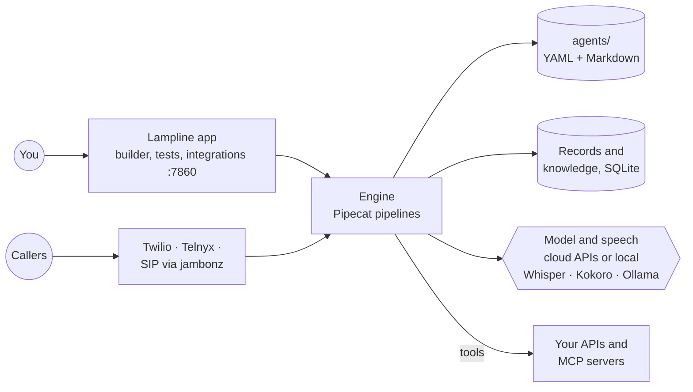

<p align="center">
  <picture>
    <source media="(prefers-color-scheme: dark)" srcset="docs/brand/lampline-logo-dark.png">
    
  </picture>
</p>

# Lampline

**Run a CX Agent Studio–style voice agent platform on your own machine in one
command, for about $0.02–0.17 per call instead of $0.50.**

[](https://github.com/C4rohan/lampline/actions/workflows/ci.yml)
[](LICENSE)
[](https://codespaces.new/C4rohan/lampline)

<!-- demo: add docs/demo.gif (build a flow, place a test call) here -->

You get a drag-and-drop flow builder, scripted pages mixed with LLM steps, a
test console (talk to the agent in the browser or replay chat turns), HTTP and
MCP tools, records and document search of its own, and phone calls over Twilio,
Telnyx or any SIP trunk through jambonz. It runs on your own machine or servers,
built on [Pipecat](https://github.com/pipecat-ai/pipecat).

- **Local first:** one command on a laptop, a GPU box or an on-prem server. No cloud account needed.
- **Private by default:** no telemetry, bound to localhost, a key on every request, keys never in your agents or the repo.
- **Any model:** Claude, OpenAI, Gemini, Vertex AI, Azure OpenAI, Bedrock, Groq, Mistral, DeepSeek, Grok, Together, Fireworks, OpenRouter, Cerebras, NVIDIA NIM, Qwen, SambaNova, Nebius, Novita, or Ollama on your own hardware.
- **Agents as code:** every agent is a folder of YAML and Markdown, reviewed in git and tested with `vk`.

## Where it runs

| | Status | |
|---|---|---|
| **Local and on-prem** | Available | One Docker container, or the engine natively, on any machine you control |
| **Google Cloud** | Coming soon | A one-command deployment to your own Google Cloud project |

## Quick start

Needs Docker with Compose v2 (Docker Desktop is fine).

```bash
git clone https://github.com/C4rohan/lampline && cd lampline
scripts/docker-up.sh                 # builds the image, starts it, prints the address to open
```

It prints a link like `http://localhost:7860/#/?key=…`: open it once and the
page remembers the key. Pick your model and voice on the Integrations page (or
put keys like `ANTHROPIC_API_KEY`, `GEMINI_API_KEY`, `DEEPGRAM_API_KEY` in
`.env`; see `.env.example`). Your agents are in `./agents` (edit them, keep them
in git) and everything else the engine keeps, settings with your keys, records,
knowledge and downloaded models, is in `./.vpe-data`.
`scripts/docker-up.sh --down` stops it; `--logs` follows its log. Plain
`docker compose up -d --build` works too once `.env` has `VPE_DOCKER_API_KEY`.
Details: [engine/README.md](engine/README.md#docker).

Prefer no Docker? `scripts/engine-up.sh` runs the engine natively (Python 3.11+)
at http://localhost:7860, which also lets browser calls reach it directly.
Free, private speech: Integrations → Whisper and Kokoro → **Download models**.

## Models

Pick one on the Integrations page; each starts on a sensible default model you
can change, and **Test connection** checks the key.

| Provider | Key |
|---|---|
| Claude (Anthropic) | `ANTHROPIC_API_KEY` |
| OpenAI, or any OpenAI-compatible endpoint | `OPENAI_API_KEY`, `VPE_LLM_BASE_URL` |
| Gemini | `GEMINI_API_KEY` |
| Gemini on Vertex AI | `GOOGLE_CLOUD_PROJECT` plus a service account key or this computer's Google credentials |
| Azure OpenAI | `AZURE_OPENAI_API_KEY`, `AZURE_OPENAI_ENDPOINT` |
| Amazon Bedrock | AWS keys, or this computer's AWS credentials |
| Groq, Mistral, DeepSeek, Grok (xAI), Together AI, Fireworks AI, OpenRouter, Cerebras, NVIDIA NIM, Qwen, SambaNova, Nebius, Novita AI | each provider's API key |
| Ollama | none: open models on this computer or your own server |

## Phone calls and SIP

| | |
|---|---|
| Twilio | a Twilio number rings your agent; outbound calls from triggers |
| Telnyx | the same, through a TeXML application |
| SIP through [jambonz](https://jambonz.org) | any SIP trunk, PBX or session border controller: point a jambonz application at the engine |

The Phone numbers page has the webhook to copy and the steps for each.
Details: [engine/README.md](engine/README.md#phone-calls-twilio-telnyx-or-sip).

### Contact centers (coming soon)

Genesys Cloud, Avaya, Cisco Webex Contact Center, Cisco UCCE and PCCE, Amazon
Connect, NICE CXone, Five9 and Twilio Flex show on the Integrations page as
coming soon. Until each lands, most of them can already send calls to your
agents over a SIP trunk through jambonz. The plan for each:
[docs/ROADMAP.md](docs/ROADMAP.md#contact-centers-coming-soon).

## How it works



The engine reads the agent folders on every call, so a change is live on the
next call. Settings and keys live in a `chmod 600` file outside the repo.

## What a voice-agent call actually costs

Monthly totals for 4-minute calls at list prices (October 2026). Staff time is
not included. Reproduce or change any assumption with `python3 costs/cost_model.py`.

| Deployment | 10k calls/mo | 50k calls/mo | 200k calls/mo |
|---|---|---|---|
| CX Agent Studio (list price, baseline) | $5,000 | $25,000 | $100,000 |
| On-prem server (no GPU) + Google model APIs | $1,384 | $6,235 | $24,426 |
| On-prem GPU servers + self-hosted models | $681 | $1,363 | $3,748 |
| Cloud Run + Google model APIs (coming soon) | $1,423 | $6,356 | $24,908 |
| GKE production + mixed vendors: Deepgram, Claude Haiku, Fish Audio (coming soon) | $1,105 | $3,612 | $13,037 |
| GKE production + self-hosted models on L4 GPUs, 3-yr CUD (coming soon) | $1,054 | $1,675 | $3,888 |

What the numbers say:
- **Hosting is the small part.** Model APIs are almost the whole bill, so the model choice matters far more than local vs. cloud.
- **Self-hosted models are where the big savings are,** but they rest on two assumptions nobody has published good data for: concurrent calls per GPU, and whether an 8B open model is good enough for your flows. [Help measure them](CONTRIBUTING.md).

Every row, per-call figures and assumptions: [costs/COSTS.md](costs/COSTS.md).

## Agents as code (`vk`)

Build and change agents from a terminal or an AI coding agent as well as the
builder. Each agent is a folder: `agent.yaml` for the graph and one Markdown
file per prompt, so changes are reviewable in git.

```bash
pip install -e cli                  # installs the `vk` command
vk templates install front-desk     # start from a ready-made agent
vk lint agents/front-desk           # graph checks + a scan for real-looking patient data
vk test agents/front-desk           # runs tests/*.yaml conversations on the engine
vk import dfcx export.zip           # bring an agent over from Dialogflow CX or CX Agent Studio
vk skills install --target claude   # builder + reviewer skills for Claude Code
```

Details in [cli/README.md](cli/README.md). The engine itself, its builder,
tools, data and knowledge: [engine/README.md](engine/README.md).

## Roadmap

- [x] The engine on Pipecat: builder, text chat, browser calls, phone calls ([engine/README.md](engine/README.md))
- [x] Agents as code: `vk` lint, conversation tests, templates, coding-agent skills ([cli/README.md](cli/README.md))
- [x] Scripted pages and flows mixed with LLM steps ([engine/README.md](engine/README.md#scripted-pages-and-flows))
- [x] Dialogflow CX and CX Agent Studio import and export ([cli/README.md](cli/README.md#import))
- [x] Records and local RAG of its own ([engine/README.md](engine/README.md#data-and-knowledge))
- [x] One Docker container for local and on-prem
- [x] 20 model providers; SIP through jambonz
- [ ] **Google Cloud deployment** (coming soon)
- [ ] **Contact centers:** Genesys Cloud, Avaya, Cisco Webex Contact Center, Cisco UCCE, Amazon Connect, NICE CXone, Five9, Twilio Flex (coming soon)
- [ ] Live-agent transfers, call recordings, published benchmarks

The full list: [docs/ROADMAP.md](docs/ROADMAP.md).

## Tested

CI runs on every push and pull request to `dev`, `qa` and `prod`:
- the `vk` CLI test suite
- the engine test suite: flows, extraction, text chat, every model provider's setup, Twilio, Telnyx and jambonz calls, the voice pipeline and a real WebRTC handshake, on fake models
- the web app builds, and the committed build matches its source
- the Docker image builds, starts as a non-root user, answers health and refuses requests without its key
- shellcheck, and a check that `COSTS.md` matches the cost model

Issues and PRs welcome (against `dev`; [how dev, qa and prod work](docs/BRANCHES.md)). See [CONTRIBUTING.md](CONTRIBUTING.md) and [SECURITY.md](SECURITY.md).

## License

Apache-2.0. The engine uses Pipecat (BSD-2-Clause), installed from PyPI;
other credits are in [NOTICE](NOTICE). Not affiliated with Google or any
provider named here. Prices are list-price estimates that change often; check
them before budgeting.
